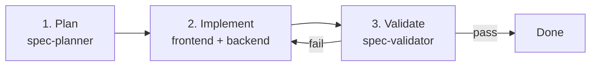
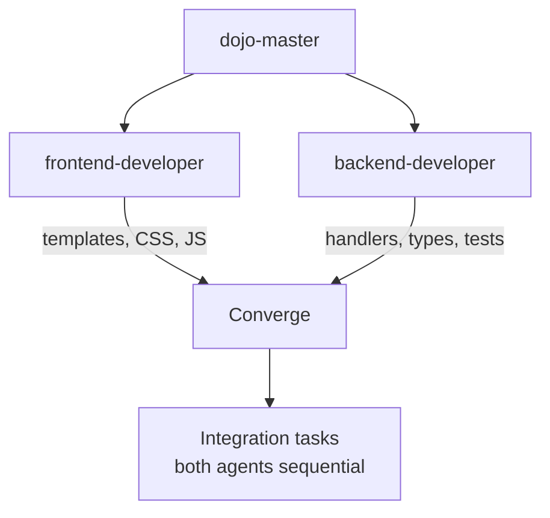
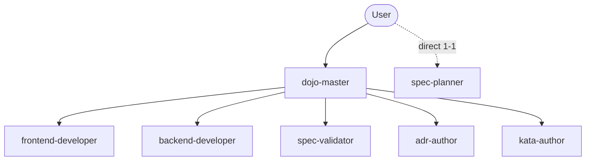
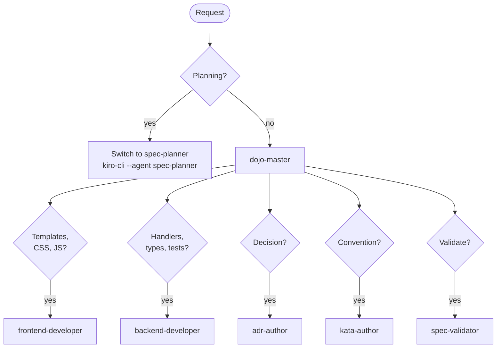

# Agent Workflow

## Feature Development



## Parallel Implementation



## Task Parallelization Example

```text
Time ──────────────────────────────────────────────►

frontend-developer │ Nav ─── JS ─── Components ──┐
                   │                              ├─► Rules listing ─► Detail ─► Tests
backend-developer  │ Handlers ─── Types ─────────┘
```

## Agent Responsibilities



## Routing



## Agents

The scopes come from each agent's profile in `.agents/profiles/`.

- **spec-planner** plans features. It writes to `specs/`.
- **frontend-developer** works on templates, CSS and JS. It writes to
  `cmd/openkata-web/templates/` and `web/static/`.
- **backend-developer** works on Go handlers, types and tests. It writes
  to `handlers.go`, `handlers_test.go` and `main.go` in
  `cmd/openkata-web/`, to `templates/types.go` and
  `templates/helpers.go`, and to `cmd/openkata-mcp/`.
- **spec-validator** reviews an implementation against its spec. It
  writes to `specs/NNNN-slug/validation-report.md`.
- **adr-author** records architecture decisions. It writes to
  `docs/adr/`.
- **kata-author** writes skills, rules and profiles. It writes to
  `skills/`, `rules/`, `profiles/`, `.agents/skills/` and
  `.agents/rules/`.
- **dojo-master** coordinates the others. It writes nothing, and
  delegates all work.

## What each agent uses

Each profile names the skills and rules its agent works with. A skill
or rule that no profile names is still available to any agent.

- **spec-planner**
  - Skills: `spec-workflow` (phases 1-3), and optionally `grill-me`,
    `grill-with-docs` and `critical-thinking`
  - Rules: markdown-style, git-naming
- **spec-validator**
  - Skills: `spec-workflow` (phase 5)
  - Rules: markdown-style
- **adr-author**
  - Skills: `create-adr`
  - Rules: markdown-style, git-naming
- **kata-author**
  - Skills: `create-skill` with `openkata-skill-conventions`,
    `create-rule` with `openkata-rule-conventions`, `create-profile`,
    `openkata-review-skill`, `openkata-review-rule`,
    `openkata-ryu-release` and `openkata-eval-runner`
  - Rules: markdown-style, git-naming
- **frontend-developer**
  - Skills: none named
  - Rules: design-system, git-naming
- **backend-developer**
  - Skills: none named
  - Rules: git-naming
- **dojo-master**
  - Skills: none, because it delegates
  - Rules: git-naming, for the `Assisted-by` trailer on delegated
    commits

The distributable skills, rules and profiles are in `skills/`,
`rules/` and `profiles/`. The local skills, which only this
repository uses, are in `.agents/skills/`.
