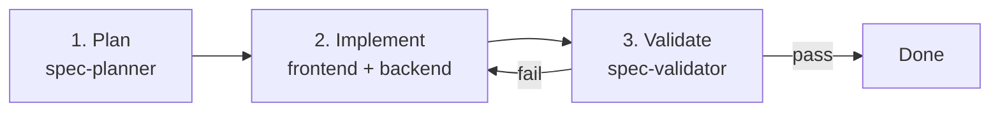
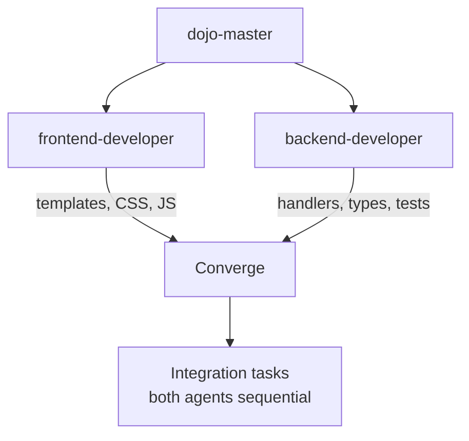

# Agent Workflow

## Feature Development



## Parallel Implementation



## Task Parallelization Example

```text
Time ──────────────────────────────────────────────►

frontend-developer │ Nav ─── JS ─── Components ──┐
                   │                              ├─► Rules listing ─► Detail ─► Tests
backend-developer  │ Handlers ─── Types ─────────┘
```

## Agent Responsibilities


## Routing


## Agents

The scopes come from each agent's profile in `.agents/profiles/`.

| Agent | Scope | Writes to |
|-------|-------|-----------|
| spec-planner | Feature planning | `specs/` |
| frontend-developer | Templates, CSS, JS | `cmd/openkata-web/templates/`, `web/static/` |
| backend-developer | Go handlers, types, tests | `cmd/openkata-web/` (`handlers.go`, `handlers_test.go`, `main.go`), `templates/types.go`, `templates/helpers.go`, `cmd/openkata-mcp/` |
| spec-validator | Acceptance review | `specs/NNNN-slug/validation-report.md` |
| adr-author | Architecture decisions | `docs/adr/` |
| kata-author | Skills, rules, profiles | `skills/`, `rules/`, `profiles/`, `.agents/skills/`, `.agents/rules/` |
| dojo-master | Coordination | nothing (delegates only) |

## What each agent uses

Each profile names the skills and rules its agent works with. A
skill or rule that no profile names is still available to any agent.

| Agent | Skills | Rules |
|-------|--------|-------|
| spec-planner | `spec-workflow` (phases 1-3); optional `grill-me`, `grill-with-docs`, `critical-thinking` | markdown-style, git-naming |
| spec-validator | `spec-workflow` (phase 5) | markdown-style |
| adr-author | `create-adr` | markdown-style, git-naming |
| kata-author | `create-skill` with `openkata-skill-conventions`; `create-rule` with `openkata-rule-conventions`; `create-profile`; `openkata-review-skill`; `openkata-review-rule`; `openkata-ryu-release`; `openkata-eval-runner` | markdown-style, git-naming |
| frontend-developer | none named | design-system, git-naming |
| backend-developer | none named | git-naming |
| dojo-master | none; it delegates | git-naming, for the `Assisted-by` trailer on delegated commits |

The distributable skills, rules and profiles are in `skills/`,
`rules/` and `profiles/`. The local skills, which only this
repository uses, are in `.agents/skills/`.
